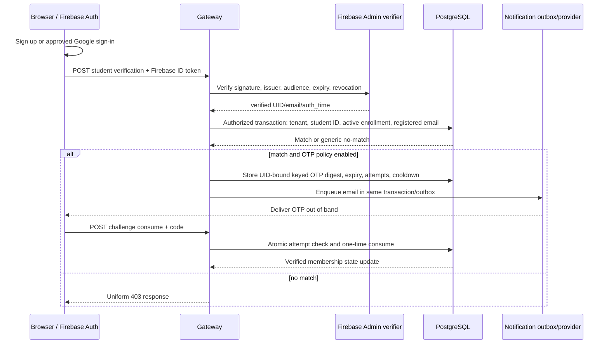

# ClassSync Master Implementation Plan

This document combines the executive audit and execution roadmap. Detailed feature statuses are in [FUNCTIONALITY_AUDIT.md](FUNCTIONALITY_AUDIT.md), risks in [BUGS_AND_ISSUES.md](BUGS_AND_ISSUES.md), security in [SECURITY_AUDIT.md](SECURITY_AUDIT.md), qualification in [TESTING_STRATEGY.md](TESTING_STRATEGY.md), and release gates in [DEFINITION_OF_DONE.md](DEFINITION_OF_DONE.md). The roadmap task register with file paths, dependencies, priorities, complexity, acceptance and tests is [MASTER_ROADMAP.md](MASTER_ROADMAP.md).

## 1. Executive Codebase Audit Summary

### What exists today

- React 19/TypeScript/Vite 6 frontend with separate presentation, development sandbox and institutional routing; Firebase email/password identity client and protected pages.
- FastAPI Gateway, Academic and Scheduling services; shared Pydantic contracts; PostgreSQL/SQLAlchemy/Alembic adapters alongside isolated SQLite sandbox/demo adapters; migrations 0001–0016 with relational integrity, membership revisioning, FORCE RLS and immutable publication history.
- OR-Tools CP-SAT generation and independent validation. Readiness, room/faculty/section/student overlap, weekly patterns, operating hours, assignment eligibility, draft/review/publish, classroom requests and role-scoped published projections have implementations and test coverage.
- Account onboarding, room directories, scanner, announcements, profile and connected workspaces have partial/implemented code. Notification service remains a health stub.

### Exact gaps and evidence boundary

- Current source is not evidence of live configuration. Login, Google OAuth, persistence after reload, reset completion, delivery, production PostgreSQL privileges/TLS, hosted migration/restore, browser role journeys, and real institutional data are UNVERIFIED.
- `services/notification/app/main.py` only exposes health. Application-side password reset completion was not found. Student roster/email verification and OTP pipeline are not implemented as requested. Generic schedule draft edit/delete surface was not found.
- The owner-supplied November 2026 DOCX lists 53 spaces: 41 row-classified as schedulable and 12 excluded; its summary conflicts (37/16). The feature-branch code catalog now maps all 53 rows to stable IDs, encodes source designation and activity restrictions, and removes obsolete IDs. Focused local tests pass; this does not verify Facilities facts or solver eligibility. No seat capacities or unspecified equipment are supplied; schedulable does not mean currently available.
- Student input rules for forms/contracts: ID `^[0-9]{2}-[0-9]{5}$` (placeholder `12-12345`, examples `24-98096`, `22-98095`; first two digits are enrollment year); lowercase dotted email local part at exact `student.pnm.edu.ph`, pattern `^[a-z]+(?:\.[a-z]+)*@student\.pnm\.edu\.ph$`, placeholder `juan.delacruz@student.pnm.edu.ph`. Roster status and exact registered-email match remain authoritative; format alone never grants identity.
- `docs/architecture.md` / `docs/production/firestore-authority.md` conflict with repository instructions and owner selection. PostgreSQL is the chosen authority; Firestore optional.
- Audit-baseline evidence on HEAD (before the current uncommitted UI follow-up): 55 focused frontend tests passed; Gateway auth/onboarding plus scheduling produced 67 passed / 1 failed, the multi-program case returning UNKNOWN under its existing 8-second guard. That baseline frontend build reported Firebase import and 692.33 kB chunk warnings. No full suite, current dependency scan, live provider/browser journey or migration rehearsal is claimed.
- Current Admin UX follow-up: no-period Academic Setup explains the required setup sequence; category routes are consolidated in the sidebar; synthetic scenario controls are separated from primary setup; Schedule Generation and deterministic conflict validation are labeled accurately; empty states have next actions. `docs/hci/admin-workspace-audit.md` gives the route-by-route evidence and preview-only gaps. Fresh focused Admin tests 31/31, typecheck, lint, build and formatting pass; the current bundle warning is 713.55 kB and browser-rendered acceptance remains unverified.

## 2. Zero-Typing Admin UI & Anti-Injection Specification

Selection-first design target: canonical catalog selects for program, cohort, section, course, faculty, room and building; multi-select chips for eligible resources; day-of-week checkboxes; 30-minute slot grid and duration presets; toggles/segmented controls for validated modes; checklist/radio rules builder for constraints; import upload with strict allowlist, preview, per-row errors, approve/reject and immutable provenance. Keep free text only for approved descriptive fields, with length/format limits. Never fabricate BSIT/BSCS/BSEd/BSBA offerings or other CdM policy: options must come from approved versioned catalogs.

Files/contracts: `apps/web/src/pages/AcademicManagementPage.tsx`, `AcademicRecordEditor.tsx`, `AcademicCalendarEditor.tsx`, `AdminSchedulingHome.tsx`, `SchedulingDraftPages.tsx`, `ConflictCenterPage.tsx`; `packages/api-contracts/classync_contracts/academic.py`, `scheduling.py`, `scheduling_security.py`, schemas and catalog JSON. Apply Pydantic `extra="forbid"`; use existing/enforced Enum/Literal for finite actions, UUID for opaque record identifiers, anchored canonical catalog keys for known room/program IDs, bounded strings for legitimate labels, and server-side referential/tenant authorization. Do not claim schemas alone prevent SQLi/XSS/SSTI/prompt injection; bound SQL parameters, output encoding, least privilege, content security policy, strict upload parser and adversarial tests are also mandatory. Room ID regex must support actual canonical IDs such as `cdm-new-function-hall` and `cdm-court`, not only numeric room suffixes.

Registrar ingestion: accept only explicitly versioned CSV/JSON schema; reject unknown headers/columns and malformed encodings; bound bytes/rows/fields; parse to staging records; normalize and compare canonical references; show preview and validation summary; require authorized human approval; atomically persist with import ID, source version, actor, timestamp and audit; support dry-run/replay/rollback without exposing full student data in logs.

## 3. System Architecture, Database Schema & Migration Plan

PostgreSQL is the single writable authority for identity membership, roster, academic records, schedules, drafts, publication, audit and outbox. Firebase Auth is identity proof; never derive role from token custom claims or browser preview. SQLite remains sandbox/local only with no production fallback. Continue Alembic after actual revision 0016; do not create `0012_student_verification_and_otp.py`, because 0012–0016 already exist.

Migration path is **0017**, not 0012 (`packages/persistence/classync_persistence/migrations/versions/0017_student_verification.py`), and only after tracing current roster storage and privacy review. Do not create duplicate writable roster authority. The following is a proposed additive challenge table contract, not approved/runnable DDL; confirm all FK names and trusted transaction context against migrations 0001–0016 first:

```sql
CREATE TABLE classync_identity.email_verification_challenges (
  tenant_id text NOT NULL REFERENCES classync_identity.tenants(id),
  id uuid NOT NULL,
  uid text NOT NULL,
  purpose text NOT NULL CHECK (purpose IN ('student_enrollment')),
  student_id text NOT NULL,
  code_hmac bytea NOT NULL CHECK (octet_length(code_hmac) = 32),
  expires_at timestamptz NOT NULL,
  attempts smallint NOT NULL DEFAULT 0 CHECK (attempts BETWEEN 0 AND 5),
  last_sent_at timestamptz NOT NULL,
  consumed_at timestamptz,
  created_at timestamptz NOT NULL DEFAULT transaction_timestamp(),
  PRIMARY KEY (tenant_id, id),
  FOREIGN KEY (tenant_id, uid) REFERENCES classync_identity.memberships(tenant_id, uid),
  CHECK (expires_at > created_at AND expires_at <= created_at + interval '15 minutes'),
  CHECK (last_sent_at >= created_at - interval '1 minute')
);
CREATE INDEX email_challenge_owner_expiry
  ON classync_identity.email_verification_challenges(tenant_id, uid, purpose, expires_at);
ALTER TABLE classync_identity.email_verification_challenges ENABLE ROW LEVEL SECURITY;
ALTER TABLE classync_identity.email_verification_challenges FORCE ROW LEVEL SECURITY;
CREATE POLICY email_challenge_owner ON classync_identity.email_verification_challenges
  USING (tenant_id=current_setting('classync.tenant_id',true)
     AND uid=current_setting('classync.uid',true))
  WITH CHECK (tenant_id=current_setting('classync.tenant_id',true)
     AND uid=current_setting('classync.uid',true));
REVOKE ALL ON classync_identity.email_verification_challenges FROM PUBLIC;
```

Keep HMAC key outside the database; authenticate `tenant + UID + purpose + challenge ID + code`. Match against canonical academic records in one authorized transaction. A CSV staging table, if approved, must be quarantined/non-authoritative and import-scoped. Add `scheduling_jobs` only after measured need; then define tenant, period, requester, input hash, status, lease, bounded attempts, timestamps and idempotency plus FK/RLS from actual scheduling schema. Do not add it speculatively.

RLS: enable and FORCE RLS on every new tenant-bearing table; policies bind `tenant_id` to transaction-local trusted context and actor UID/current membership. Student challenge access is owner-only; privileged roster lookup is an authorized service transaction; no client direct access. Runtime role gets only required SELECT/INSERT/UPDATE; migration owner separate; no BYPASSRLS/table ownership. Revoke direct challenge/roster writes from browser roles. Tests must prove no-context, cross-tenant, cross-UID and revoked access are denied. New table/migration remains tentative until schema inspection against current 0001–0016 and DPO/Registrar review.

Cutover is not authorized here. First select a provider only after validating current terms, region, privacy, availability, backup, restore, connection support, budget, and institutional approval. Supabase currently advertises 500 MB Free DB and pauses inactive projects after one week, with no automatic backups on Free; that is not a production SLA. Neon current free limits must be checked from official pricing before selection. Configure TLS verification (`sslmode=verify-full` where supported; do not weaken to `require` without hostname verification review), bounded pool/checkout, cold-start retry with safe deadline, health/readiness and circuit handling. Use synthetic migration rehearsal, counts/checksums, RLS and restore before any separate approved import/cutover.

## 4. Authentication, Student ID Verification & Email OTP Flow



Endpoint proposal: `POST /api/v1/auth/verify-student` with `student_id` and the student's institutional email, request ID and idempotency key; a bearer Firebase token is required. The submitted email, verified Firebase token email and active Registrar-record email must match exactly after canonical lowercase normalization. Backend performs revoked-token verification then a parameterized tenant-scoped query against authoritative PostgreSQL academic student records. Do not create a membership until active/enrolled record and all email bindings are verified. Response body/status and UI text are identical for missing ID, inactive enrollment and mismatch. Configured exact UI constant: **“Student ID or registered email could not be verified. Please check your information or contact the Registrar.”** Keep existence-independent timing within a bounded response window; absolute network timing equality cannot be guaranteed. Apply IP/UID throttles and avoid logging identifiers. `check_revoked=True` is required at Firebase Admin boundary.

If OTP is required, use 6 numeric digits, cryptographic RNG, keyed HMAC-SHA256 at rest (not bare SHA-256), 15-minute expiry, maximum five failed attempts, one-time atomic consumption, 60-second resend cooldown, per-IP/UID quotas and replay/race tests. These values are proposal defaults and must be approved against policy and usability. Prefer Firebase native email verification/action links for standard address verification; Resend is a possible transactional provider subject to institution domain, current terms and operational approval; Brevo is an evaluated alternative, not automatic failover with multiple copies sent. Provider failover must use idempotent event IDs and avoid duplicate delivery.

## 5. UI/UX & motion.dev Component Specification

Product direction: clean, restrained, non-generic university software with purposeful minimal icons, clear hierarchy and smooth transactions. Do not introduce glassmorphism or conspicuous decorative effects. Preserve useful existing patterns while improving inconsistent flows. Evaluate installing `motion` and importing from `motion/react` only after baseline functional/keyboard work and bundle measurement; motion remains optional under the hard $0/month operating cap.

- App root: one `LazyMotion features={domAnimation} strict` and `MotionConfig reducedMotion="user"`; avoid nested providers.
- `AuthPage.tsx`: single-screen sign-in/onboarding progression, `AnimatePresence mode="wait"`; labeled controls, password manager/autofill, visible loading/errors, proper Firebase action-link continuation; no decorative motion blocks submission or focus.
- Drawers/modals/dialogs: `apps/web/src/components/ui/Drawer.tsx`, Modal and DialogSurface; spring enter/exit, focus trap/restore, Escape/close, inert background and reduced-motion instant/opacity fallback.
- Role tabs/day/building filters: shared `layoutId` only for selected indicator; ensure `aria-selected`, keyboard arrow/home/end semantics and no layout animation when reduced motion requested.
- Timetable/room cards: short opacity/position stagger, bounded list size, no animation on large grids that delays critical content.
- Acceptance: test no motion preference, reduced motion, keyboard, focus, screen reader labels, 360–1440 responsive widths, 200% zoom, performance and emitted chunk budget.

## 6. AI Copilot & CP-SAT Solver Enhancement Plan

CP-SAT in `services/scheduling/app/engine.py` remains sole mathematical authority; `constraint_model.py` holds hard constraints, `objectives.py` soft scores, `readiness.py` inputs and `validation.py` independent acceptance. No LLM can create/relax/approve/publish constraints. First diagnose current UNKNOWN regression under the existing 8-second test budget.

Structured constraint builder emits schema-validated opaque canonical IDs, target, condition enum, weekdays/slot ranges and priority. Future LLM only explains redacted diagnostics or maps an explanation to a suggested existing control; a human selects it, then the backend recomputes readiness and CP-SAT independently. Strip names, emails, student IDs and free-text PII; do not send raw rosters. Model output is untrusted; validate exact schema and allowlisted IDs. Fail closed on 429/503/timeouts; explain solver diagnostics without AI. No current Gemini/Groq/OpenRouter free quota or model version is promised. Confirm terms, quotas, retention, region, key security and per-provider spend controls at implementation time.

Future measured enhancements: inter-building travel buffers, fatigue/break constraints, verified equipment compatibility, move precheck using `validate_timetable(..., partial=True)`, warm-start locked assignments, and async job status only if current measurements show need. Every new hard rule needs documented CdM policy and independent validator parity. Async queue requires lease/retry/idempotency/cancellation and bounded worker resources; do not add speculative `scheduling_jobs` before load evidence.

## 7. Cybersecurity & Cloudflare Defense Matrix

| Layer              | Planned control                                                                                                                                                                                               | Acceptance / limitation                                                                                                             |
| ------------------ | ------------------------------------------------------------------------------------------------------------------------------------------------------------------------------------------------------------- | ----------------------------------------------------------------------------------------------------------------------------------- |
| Cloudflare DNS/TLS | Proxy only approved public hostname; Full (strict) with valid origin certificate; no secrets/origin bypass exposure.                                                                                          | Owner-managed setting; verify end-to-end TLS and origin reachability. No account changes in this audit.                             |
| Edge rate limiting | Current Free plan features are limited; official WAF summary currently lists one rate-limit rule on Free. Use that rule for highest-risk auth or document app limits for scheduling; recheck plan capability. | Test actual rule behavior and false positives; quotas/actions vary by plan. Do not assume Bot Fight/WAF managed rules are all free. |
| FastAPI CORS       | Environment-driven exact allowed origins; no wildcard credentials.                                                                                                                                            | OPTIONS/actual origin tests on Gateway; align same-origin deployment.                                                               |
| App rate limits    | Shared distributed IP + Firebase UID limits; local per-process buckets are insufficient across replicas.                                                                                                      | Burst, retry-after, bypass/header spoofing, multi-instance tests.                                                                   |
| Security headers   | CSP, HSTS on HTTPS, `nosniff`, frame denial, Referrer-Policy, Permissions-Policy.                                                                                                                             | Inspect real edge responses; CSP nonce/hash and Firebase/API origins explicitly reviewed.                                           |
| Identity/data      | Token + current PG membership each protected service; FORCE RLS; least privilege; no SQL/SQLite fallback; no browser authority.                                                                               | IDOR/tenant/record/revocation/outage matrix; non-owner runtime DB roles.                                                            |
| Leakage            | Generic error envelope, request ID, no PII in URLs/logs/AI prompts; masked admin data; redacted scan receipts.                                                                                                | Automated log/response scanning with synthetic sentinels.                                                                           |
| Dependencies       | npm audit, pip-audit, lock integrity, pinned reviewed CI actions.                                                                                                                                             | Current scan and exact commit CI required; no suppression without policy authorization.                                             |

## 8. MVP Sources, Datasets & Credentials Checklist

| Needed item                           | Source / destination                                                                                                                  | Gate                                                                                                                                                                                                                                                                        |
| ------------------------------------- | ------------------------------------------------------------------------------------------------------------------------------------- | --------------------------------------------------------------------------------------------------------------------------------------------------------------------------------------------------------------------------------------------------------------------------- |
| Student masterlist                    | Registrar-approved export: student key, registered email, enrollment state, program/cohort/section; avoid unnecessary attributes.     | Data owner, purpose, consent/legal basis, transfer method, access, retention and deletion approval.                                                                                                                                                                         |
| Faculty load/eligibility/availability | Registrar/dean-approved structured source with stable faculty IDs, workload and date range.                                           | Confirm authority and effective term; never infer preferences.                                                                                                                                                                                                              |
| Curriculum and course offerings       | Approved CHED/CdM versioned curriculum, contact minutes, prerequisites, cohort mappings.                                              | Source/version owner and completeness attestation.                                                                                                                                                                                                                          |
| 53 CdM spaces                         | November 2026 DOCX row inventory; mapping in `ROOM_INVENTORY_UPDATE.md`; code catalog synchronized and locally tested on 15 November. | Maintain 53 unique IDs, row-derived 41 schedulable/12 excluded, 33 lecture/4 computer labs/1 restricted science lab/3 activity spaces; keep the 37/16 discrepancy visible. Obtain Facilities verification before operational use; infer no capacity/equipment/availability. |
| Calendar/holidays                     | Approved academic calendar and instructional day exceptions.                                                                          | Registrar signoff and timezone policy.                                                                                                                                                                                                                                      |
| PostgreSQL                            | Evaluated provider and service URLs/TLS roots/pool limits.                                                                            | $0 quota, pause, backup, restore, region, privacy, availability, terms, billing alert and approval; no real data until separately authorized.                                                                                                                               |
| Firebase Auth                         | Project ID, allowed domains, Email/Password and optional Google provider, email templates/action URLs.                                | Owner-controlled project; separate dev/emulator/staging/production; no client secrets.                                                                                                                                                                                      |
| Email provider                        | Resend/Brevo/Firebase native action link credentials and verified domain DNS.                                                         | Current free allowance/terms, SPF/DKIM/DMARC, privacy/subprocessor review, suppressions, bounce/outage plan. Never place keys in frontend.                                                                                                                                  |
| Cloudflare                            | Zone/DNS ownership, origin certificate, Full strict, selected free WAF/rate rule.                                                     | DNS/domain owner approval; confirm current Free capability and origin security.                                                                                                                                                                                             |
| AI providers (optional)               | Gemini/Groq/OpenRouter credentials held server-side only.                                                                             | Do not request until AI feature is approved; current free tiers/terms/retention verified; quotas and budget kill switch.                                                                                                                                                    |
| Hosting                               | Static frontend + API host, runtime limits, network and logs.                                                                         | Hard $0/month cap; current free tier and cold-start/egress/storage limits; privacy, availability, backup and recovery must pass. If no provider passes, production launch is BLOCKED; no paid-tier assumption or weakened gate.                                             |
| Privacy/operations                    | DPO contact, notice/consent text if required, incident path, backup owner, support operators.                                         | CdM approval; RA 10173 applicability and lawful basis reviewed by authorized privacy/legal stakeholder.                                                                                                                                                                     |

## 9. Phased Sprint Roadmap & QA Acceptance Gates

Follow `MASTER_ROADMAP.md` Phases 0–5; the first five tasks are authority-doc reconciliation, exact-commit requalification, Registrar/facilities scope verification (including the 53 row-mapped rooms and discrepancy), solver UNKNOWN diagnosis, and academic input/readiness completion. Do not start AI, motion, hosted cutover or real-data ingestion ahead of identity/data/scheduling gates. The current solver UNKNOWN remains open under its existing time limit and constraints.

### Exact gate commands

```powershell
# Web, lockfile and security gates
npm ci
npm run typecheck --workspace=@classync/web
npm run lint --workspace=@classync/web
npm run test:web
npm run build --workspace=@classync/web
npm run build:presentation
npm run test:security
npm audit --audit-level=moderate

# Python, from repo root and isolated project venv
.venv/Scripts/python.exe -m ruff check services packages
.venv/Scripts/python.exe -m pip_audit --strict
.venv/Scripts/python.exe -m pytest -q
.venv/Scripts/python.exe -m pytest services/scheduling/tests -q

# Browser: use only the checked-in qualification wrapper documented by --help;
# use owned Auth/DB emulators, a disposable PostgreSQL cluster, a new output dir,
# and preservation receipt. Run Student/Teacher/Admin flows at 360/390/768/1024/1440
# plus native 200% zoom, keyboard/reduced motion and negative auth/scheduling cases.
```

The exact Playwright script and flags must be verified from the current checkout before running; do not guess or invoke historical workstation-specific commands. Current-commit release gate also requires actual migration upgrade/restore, security headers/rate limits, API negative paths, publication concurrency/idempotency, backup recovery, and independent review. Any unavailable provider or manual assistive-technology check remains UNVERIFIED. A failure is diagnosed once within approved scope; no timeout increase, skipped test, softened hard constraint or green-status substitution is permitted.

### Current provider references (checked 15 November 2026)

- [Neon Free plan update](https://neon.com/blog/neon-free-plan-1-gb-per-project): provider reports 100 projects, 100 CU-hours per project/month, 1 GB storage per project and scale-to-zero. Quotas and product scope can change; no backup/SLA guarantee is inferred here.
- [Supabase pricing](https://supabase.com/pricing) and [inactive project behavior](https://supabase.com/kb/faqs/platform/free-postgres-for-side-projects): Free currently lists 500 MB database/project, 50,000 MAU, and pause after one week of low activity; automatic backups are not included on Free. It is a fallback candidate only if pause/recovery/privacy requirements pass.
- [Resend pricing](https://resend.com/pricing): Free currently lists 3,000 emails/month and 100/day. Quota does not establish deliverability or permission to send student records; message content must be minimized and DPA/retention assessed.
- [Cloudflare rate-limit plan availability](https://developers.cloudflare.com/waf/rate-limiting-rules/): Free currently has one rate-limit rule, limited path/verified-bot matching and IP counting; it cannot supply per-Firebase-UID limits. Put fine-grained limits in the application/shared store. Recheck current capabilities before setup.
- [Motion reduced bundle guide](https://motion.dev/docs/react-reduce-bundle-size) and [MotionConfig reduced motion](https://motion.dev/docs/react-motion-config): `LazyMotion`, `domAnimation`, strict loading patterns and `reducedMotion="user"` are documented APIs. Validate current package compatibility and actual output bundle before adoption.

These are provider-published plan snapshots, not recommendations to create accounts or assertions that the full application can run reliably at $0/month. Cloudflare, mail, hosting, model and database terms, quotas, regional data handling, backups, pause/cold-start and account eligibility require owner review at execution time.
