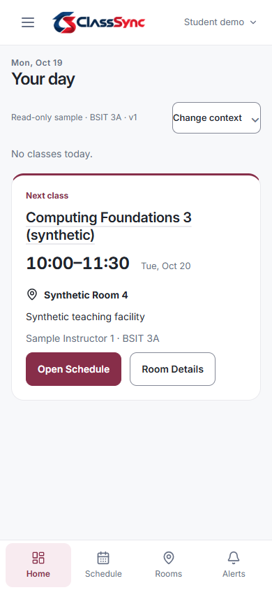
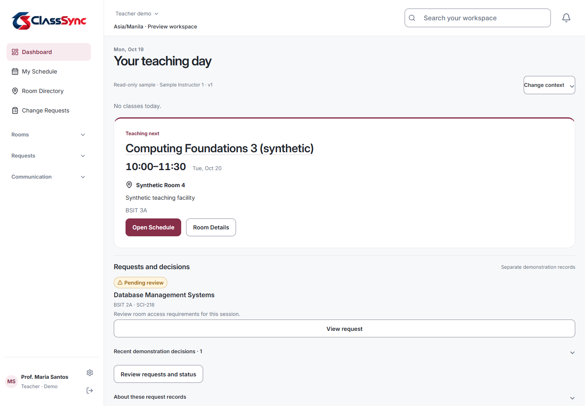
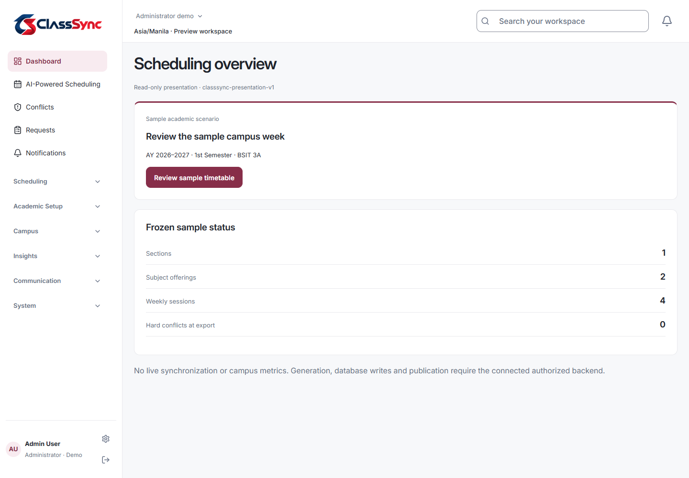
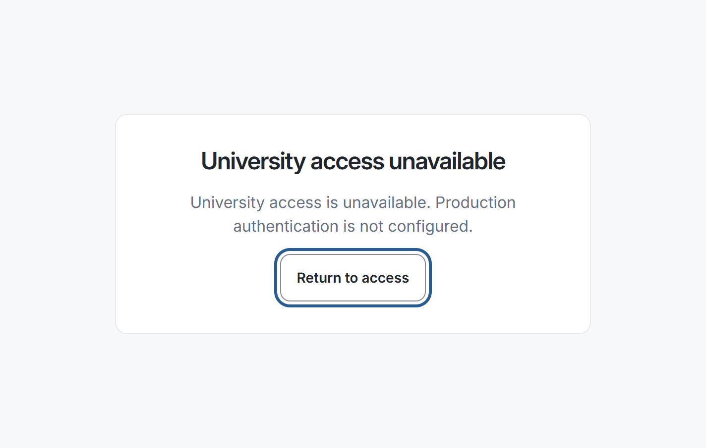
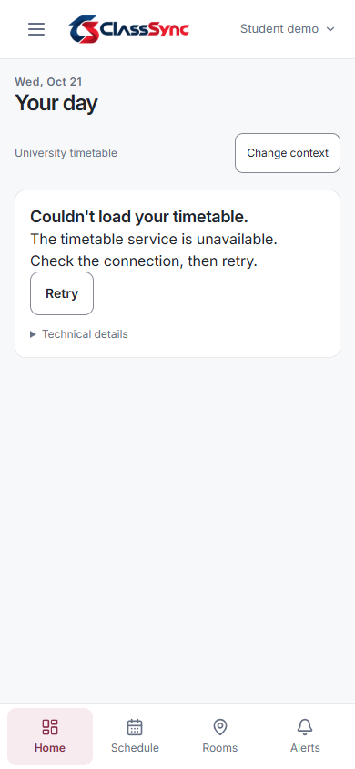

# P1 security and release-gate closure — 21 October 2026

## A. Executive summary

**P1 LOCAL SECURITY GATE: FAIL. P2 ENTRY RECOMMENDATION: NO-GO. INSTITUTIONAL PRODUCTION RELEASE: NO-GO.**

Functional regression verification passes. Six of the seven previously registered JavaScript advisories are fixed; one high advisory remains unresolved across five development-package entries. No owner risk exception exists. Python scanning is now operational: eight distinct advisories discovered in three packages were fixed, and the final scan covers 62 exact third-party versions with zero findings and zero skips. A clean production-only npm scan does not erase the development-tooling finding.

The hosted public alias is not the locally verified presentation artifact: nested refreshes and release metadata return 404, Student/Teacher journeys request an unavailable API, and its deployed SHA cannot be established. Private Vercel settings are inaccessible. No deployment has been performed or approved. Existing local P1 functional PASS and this security FAIL describe different gates.

Machine-readable before/after audit responses, browser results, data preservation and task-delta inventory are in [the evidence file](p1-gate-closure-evidence.json). Selected actual screenshots are in [the evidence directory](p1-gate-closure/). Earlier P1 reports remain historical evidence, not fresh results for this task.

## B. Scope and safety

- Branch `main`, HEAD `39200a4f2ef3ec7557bc3c86127e674e260ca4fc`, unchanged. The task began with the preceding P1 implementation uncommitted: 38 tracked/untracked file changes, not a clean tree. A task-start file-hash inventory and status were retained before edits; subsequent work was compared against that inventory rather than attributing every Git diff to this task.
- Node 22.23.1 / npm 10.9.8; project requires Node 22.x. Project Python 3.12.14 satisfies >=3.12. npm workspace package-lock v3 is authoritative for JavaScript; Python uses four requirements manifests plus editable local contracts, not a full deployment lock.
- Only targeted dependency pins/overrides, security tests/scanning, CI and documentation changed. No React runtime source, logo, CSS, API contract, solver or service application code changed during this closure task. All 208 protected source/brand/contract/service files compared unchanged to task start. Generated CSS is byte-identical (SHA256 `3817d76d0ddb2a3799e3dfba586c4a125989414b38a9059c01603ae11cafcc50`).
- No original database writes, schema changes, seeds, migrations, Firebase changes, cloud settings, commit, push, provisioning or deployment. P2 has not begun. Installed app-venv changes are limited to certifi, pytest and pip; the scanner lives in a separate temporary venv. No global Python/npm replacement or forced dependency upgrade occurred.

## C. Exact file inventory

This list is the closure-task delta, not the larger uncommitted P1 diff:

| File | Purpose |
|---|---|
| `.github/workflows/quality.yml` | Least-privilege checkout/token settings; dependency smoke tests; exact Python scanner job; unsuppressed npm advisory gate |
| `package.json` | Two targeted dependency overrides and `test:security` script |
| `apps/web/package.json` | Pin tested Vitest 4.1.11 |
| `package-lock.json` | Resolved patched targets, compatible Vitest tree and grpc support dependencies; tinypool removed |
| `services/gateway/requirements.txt` | Shared security constraints and patched pytest range |
| `services/academic/requirements.txt` | Same |
| `services/scheduling/requirements.txt` | Same |
| `services/notification/requirements.txt` | Same |
| `services/security-constraints.txt` (new) | Pin certifi 2026.10.19, pytest 9.0.3 and pip 26.2.2 |
| `scripts/security/python_audit.py` (new) | Verify manifests/internal provenance; scan exact installed versions; fail closed on incomplete/error results |
| `scripts/tests/dependency-security.test.cjs` (new) | Three installed-version/API/build-compatibility smoke tests |
| `services/scheduling/tests/test_security_audit.py` (new) | Twelve scanner coverage/provenance/error regression tests |
| `services/scheduling/tests/test_mode_boundaries.py` | One missing-Firebase-credentials rejection test added to pre-existing uncommitted P1 tests |
| `docs/security.md` | Current security/scanner gates, without claiming institutional readiness |
| `docs/infrastructure/vercel-backend-deployment-plan.md` | Correct presentation build command/mode; distinguish historical observations and current hosted failures |
| `docs/production/dependency-advisory-register.md` | Current dispositions, preserving original 14-entry triage below |
| `docs/production/p1-gate-closure-report.md` (new) | This report |
| `docs/production/p1-gate-closure-evidence.json` (new) | Audits, browser/hosted/data evidence and exact task-change hashes |
| `docs/production/p1-gate-closure/student-390.png` (new) | Actual production-artifact Student screenshot |
| `docs/production/p1-gate-closure/teacher-1440.png` (new) | Actual production-artifact Teacher screenshot |
| `docs/production/p1-gate-closure/administrator-1440.png` (new) | Actual production-artifact Administrator screenshot |
| `docs/production/p1-gate-closure/native-200-percent.png` (new) | Actual isolated Chrome native-zoom capture |
| `docs/production/p1-gate-closure/hosted-student-390.png` (new) | Actual public alias failure state |

Dependency tool caches, temporary venvs, disposable test databases and build outputs are local generated artifacts, not additional source changes. Pre-existing P1 mode/configuration/component changes remain preserved. `git diff --check` and final task-hash comparison are recorded in the evidence.

## D. Advisory resolution matrix

### JavaScript: seven advisories, fourteen original affected-package entries

Sources are the linked GitHub advisories, fresh npm registry audit responses and actual installed dependency trees. Severity on a parent entry can be inherited; it does not mean every parent has a separate vulnerability. No advisory was ignored or accepted as risk.

| Advisory | Package / original version | Final version | Scope / reachability | Resolution | Verification |
|---|---|---|---|---|---|
| [GHSA-m9gg-hp2v-232j](https://github.com/advisories/GHSA-m9gg-hp2v-232j), high | grpc-js 1.9.16, through firebase 11.10.0 → firestore 4.8.0 / compat 0.3.53 | grpc-js 1.14.5; Firebase parents retained | Node grpc certificate-authentication path; no app grpc server or emitted browser grpc/Firestore module | **FIXED** | Exact override/installed version, Node metadata/Firestore-load smoke test, full npm audit no longer reports G1 |
| [GHSA-f596-whhp-79r4](https://github.com/advisories/GHSA-f596-whhp-79r4), low | Same chain | Same | Node grpc server error disclosure; no such app server identified | **FIXED** | Same patched branch and audit |
| [GHSA-82fw-gwwq-j7x9](https://github.com/advisories/GHSA-82fw-gwwq-j7x9), moderate | vitest / mocker 3.2.7 | Both 4.1.11 | Test/mock-server file access; not a production browser API | **FIXED** | Installed versions; all 664 tests on Vitest 4.1.11; Vite retained at 6.4.4 |
| [GHSA-vfj7-8cjw-p6xm](https://github.com/advisories/GHSA-vfj7-8cjw-p6xm), high | braces 3.0.3, via Tailwind/chokidar/micromatch/fast-glob | Unchanged 3.0.3 | Untrusted deeply nested glob patterns can exhaust stack in build/watch tooling | **UNRESOLVED** | Latest registry version still affected; full audit has five high entries. Trusted current globs and browser exclusion reduce exposure, but are not a complete mitigation or exception |
| [GHSA-rj75-hqrm-r3gf](https://github.com/advisories/GHSA-rj75-hqrm-r3gf), moderate | postcss-selector-parser 6.1.4 via Tailwind / postcss-nested 6.2.0 | Parser 7.1.6; parents retained | CSS selector input can cause CPU exhaustion in tooling | **FIXED** | Real Tailwind/nested-selector processing smoke test, both builds, byte-identical CSS, audit cleared |
| [GHSA-5gmw-xhrv-c9v3](https://github.com/advisories/GHSA-5gmw-xhrv-c9v3), critical | tinypool 1.1.1 via Vitest | Removed by Vitest upgrade | Worker-options prototype pollution gadget; requires an exploitable input/pollution chain | **FIXED** | No tinypool lock node or emitted module; full audit cleared; unchanged suite passes |
| [GHSA-85c8-ppgw-ccpr](https://github.com/advisories/GHSA-85c8-ppgw-ccpr), critical | Same | Removed | Run-options pollution gadget | **FIXED** | Same removal and regression evidence |

Entry reconciliation: original 14 (2 critical / 9 high / 3 moderate) → final **5 high / 0 critical / 0 moderate**. Remaining entries: braces 3.0.3, chokidar 3.6.0, fast-glob 3.3.3, micromatch 4.0.8, tailwindcss 3.4.19, all propagating B1. Nine original entries clear. The production-only audit reports zero findings, but build/CI tooling still matters. The actual presentation module graph has 173 modules and zero Firestore/grpc/test/build-tool matches; this supports browser exclusion only for this artifact.

Compatibility rationale: retain React, Vite, Firebase and Tailwind versions; upgrade the test runner to a patched version compatible with Node 22 and existing Vite; override only the two vulnerable transitive packages. grpc's old parent semver range requires an explicit override, qualified by actual Node import/API smoke tests, not a claim that all future Firestore operations are certified. No live Firestore calls were made. Parser compatibility is checked through the actual CSS toolchain. Broad Tailwind 4 migration is outside this narrow task.

### Python: fifteen raw records, eight distinct advisories

Duplicate scanner records were deduplicated by package/advisory ID; aliases do not count as additional advisories. Raw before/after responses are retained. All eight are **FIXED**, not suppressed:

| Advisory | Package | Original → final | Scope / impact and verification |
|---|---|---|---|
| [PYSEC-2026-4320 / GHSA-6q48-6c7w-9gw2](https://github.com/advisories/GHSA-6q48-6c7w-9gw2) | certifi | 2026.7.22 → 2026.10.19 | Runtime/tool outbound HTTPS CA trust; compromised chain enables on-path interception. Patched trust bundle, pinned constraints, final scan clear |
| [PYSEC-2026-1795 / GHSA-4xh5-x5gv-qwph](https://github.com/advisories/GHSA-4xh5-x5gv-qwph) | pip | 25.0.1 → 26.2.2 | Archive extraction fallback; Python 3.12 already avoids that fallback, and patched pip removes the registered finding |
| [PYSEC-2026-1796 / GHSA-6vgw-5pg2-w6jp](https://github.com/advisories/GHSA-6vgw-5pg2-w6jp) | pip | Same | Malicious wheel extraction path traversal; fixed since 26.0 |
| [PYSEC-2026-2875 / GHSA-58qw-9mgm-455v](https://github.com/advisories/GHSA-58qw-9mgm-455v) | pip | Same | Ambiguous concatenated archive handling; fixed since 26.1 |
| [PYSEC-2026-2876 / GHSA-jp4c-xjxw-mgf9](https://github.com/advisories/GHSA-jp4c-xjxw-mgf9) | pip | Same | Deferred self-update imports after install; fixed since 26.1 |
| [PYSEC-2026-196 / GHSA-wf93-45jw-7689](https://github.com/advisories/GHSA-wf93-45jw-7689) | pip | Same | Entry-point path escape; fixed since 26.1.2 |
| [PYSEC-2026-3721 / GHSA-qwm4-qh6w-59xr](https://github.com/advisories/GHSA-qwm4-qh6w-59xr) | pip | Same | Malicious-index encoded URL path handling; fixed since 26.2 |
| [PYSEC-2026-1845 / GHSA-6w46-j5rx-g56g](https://github.com/advisories/GHSA-6w46-j5rx-g56g) | pytest | 8.4.2 → 9.0.3 | UNIX temporary directory attack, relevant to Linux CI even though local Windows path is unaffected. All 105 backend tests pass on patched pytest |

Owners: application/build maintainers are suggested; accountable security-risk owner remains **unassigned**. Only the product/security owner may approve an exception. No exception is implied by this report. Combined scanned advisory totals: **14 distinct fixed, 1 unresolved, 0 accepted exceptions, 0 unverified registered advisories**. This is not a guarantee that scanners detect every vulnerability.

## E. Python security scanning

[pip-audit](https://github.com/pypa/pip-audit) **2.10.1** runs in `%TEMP%/classsync-p1-gate-tools`, separately from the application `.venv`. The scanner script executes with app Python, inventories its exact installed versions, verifies requirements from Gateway, Academic, Scheduling and Notification, and passes exact pins to the tool using `--no-deps --disable-pip`. No resolver, automatic fix or global install runs during scanning.

The sole non-PyPI package, `classync-api-contracts==0.1.0`, must have editable `file:` provenance pointing to this repository's `packages/api-contracts`; it is reviewed and tested as source, not silently skipped as a third-party package. Every other installed package, including pip, pytest and Ruff, must appear exactly once at the same version in the report. Missing/duplicate/mismatched/skip records, invalid scanner version, network failure, timeout, stale/missing report and exit/result disagreement fail closed. Twelve tests cover these rules.

Final: **62 exact third-party packages, zero findings, zero skips**, `pip check` passes. All four manifests verified. Before: 15 raw records / eight distinct advisories / three packages. Security constraints pin only remediated targets; the rest remain existing bounded ranges, so a complete hashed deployment lock and a fresh Linux cloud-image scan remain future release work. The no-deps warning recommends hash locking; it was not hidden or treated as a failure. Scope is the installed local union, not an unbuilt future Linux image.

CI creates the same isolated scanner, bootstraps patched pip/pytest, installs all four services, and runs the fail-closed script. An independent npm job uses `npm ci --ignore-scripts` and `npm audit --audit-level=low`; no continue-on-error, ignore list or forced fix exists. **That npm job is expected to fail while B1 remains.** Workflow syntax/policies were checked locally using installed js-yaml. GitHub Actions were not triggered; no hosted CI PASS is claimed.

## F. Production boundary validation

| Boundary | Fresh evidence / outcome |
|---|---|
| Presentation | Frozen versioned sample remains consistent across all three role journeys, zero API requests, no generation/save/publish submission; PASS |
| Institutional frontend | Forged preview role, browser storage and query mode cannot grant access; all three role routes remain honestly unavailable at 390/1440 and after refresh; PASS. Real institutional login is not implemented/certified |
| Sandbox artifact | Actual build tests reject nine invalid configurations, including distributable sandbox regardless of NODE_ENV/build-mode semantics; PASS |
| Backend | Development environment + explicit sandbox enable required independently by services; protected operations require verified identity/Administrator; existing role/authorization tests pass. New missing-Firebase-credential test returns generic 401; frontend flags are not authorization |
| Expiry/refresh | Invalid/expired sessions clear safely, mounted eight-hour expiry returns to entrance, valid role refresh persists; PASS |
| Routing/static/API | Actual ordinary/presentation/compatible-legacy builds served through repository SPA emulation; all role prefixes refresh, assets stay assets, missing API/static paths retain errors; PASS locally only |
| Metadata | Legacy `mode: read-only-presentation`, appMode, capabilityVersion, sampleVersion, HEAD and dirty state remain compatible in built artifacts; PASS. The dirty local artifact is not a clean deployed commit |
| Secrets/debug | Runtime/CI diff review found no new secrets, token logging or production debug API exposure. Missing Firebase configuration fails protected access closed. Deployed secrets/IAM/rules were not accessible and are not certified |

The current backend uses existing UID/claim ownership checks, not future tenant/current-membership authorization. No production authentication architecture or Firebase rules/settings were altered. Deny-all rules in source do not prove deployed rules. Backend tests and artifact tests are complementary; browser navigation alone does not prove API authorization.

## G. Vercel deployment verification

Read-only requests and actual fresh-profile Chrome journeys were made against the public alias. No write controls were activated.

| Item | Repository/local | Actual hosted observation |
|---|---|---|
| SHA | Intended source HEAD `39200a4f2ef3ec7557bc3c86127e674e260ca4fc` plus disclosed uncommitted P1/security changes | **Unknown**; `/release.json` 404; do not substitute a GitHub deployment record as proof |
| Mode | Intended `presentation`, sample v1, no API access | Exact enum **unverifiable**; observed connected-preview behavior makes failing timetable requests, inconsistent with intended presentation |
| Root | Local production artifact 200 | `/` 200, client-side role selection works |
| Deep routes | Local SPA test passes | `/student/dashboard`, `/teacher/schedule`, `/admin/dashboard`, `/dev/role-preview` 404 plain text; refresh on each selected role fails |
| Assets | Static precedence passes | Main JS, logo, 32px favicon, Inter and manifest all 200 |
| Missing routes | Correct local error handling | Unknown route/missing asset/API timetable path all 404; no reachable backend established |
| Project settings | `vercel.json`: repository root assumption, presentation build, `apps/web/dist`, explicit frontend rewrites excluding API/static | Root Directory/build/output/env **not verified**; private project endpoint returned 403; no linked `.vercel/project.json`/Vercel CLI access |

**Hosted route/release verification: FAIL; SHA/settings verification: BLOCKED. No VERCEL PASS.** Public Student/Teacher Home shows a timetable load error after `GET /api/v1/timetables/periods` returns 404. Hosted Administrator shows the older connected prompt, not this local frozen-sample overview. These are observed behaviors, not an inferred deployment SHA.

Owner closure actions, only after separate release approval: inspect Vercel Root Directory `.`, Node 22, `npm ci`, build `npm run build:presentation`, output `apps/web/dist`; use canonical presentation configuration with compatible legacy flags (or unset them), no sandbox, no localhost API. Review the exact clean candidate commit, unresolved advisory gate, staging deployment and verified rollback first. Then separately authorize commit/push/deployment. After deployment verify manifest SHA against that candidate, all role deep refreshes, static assets, no API requests and mode metadata on the actual alias. No settings changes were made here. Owners are currently unassigned; these block public cutover independently of local success.

## H. Regression test matrix

| Area | Reported baseline | Fresh final result | Evidence |
|---|---|---|---|
| Lint / TypeScript | PASS | **PASS**, zero lint warnings | `npm run lint`, `npm run typecheck` |
| Frontend | 664 | **664 passed**, 36 files, Vitest 4.1.11, 152.13s | Full `npm run test:web`, not selected-suite substitution |
| Backend | 92 | **105 passed**, 59.02s | Disposable DB paths; 12 scanner tests + one credential rejection added; existing Starlette/httpx deprecation retained |
| Ruff | PASS | **PASS** | `ruff check scripts/security services packages` |
| Dependency smoke | Not present | **3 passed** | Actual installed versions, grpc/Firestore Node load, selector/Tailwind processing |
| Ordinary build | PASS | **PASS** | Main 519.95 kB / 154.28 kB gzip |
| Presentation build | PASS | **PASS** | Main 524.87 / 155.61 kB gzip; lazy sample 31.91 / 2.00; CSS 84.64 / 15.87 kB, unchanged bytes |
| Artifact/SPA security | PASS | **4 top-level groups passed**, 75.115s | Nine rejected configurations, three actual artifact variants + HTTP/API/static/metadata checks |
| npm full / production audit | 14 package entries | **FAIL: five high / PASS: zero production findings** | Fresh final JSON; all five are B1, not five new distinct advisories |
| Python scan / consistency | Scanner unavailable | **PASS: 62 scanned, zero findings/skips; pip check PASS** | Isolated pip-audit 2.10.1; raw before/after retained |
| Complete npm tree | Not certified | **FAIL: pre-existing optional AJV peer mismatch** | @hookform/resolvers 5.9.1 optional ajv ^8.12.0 vs ESLint-hoisted ajv 6.15.0; both exact baseline resolutions unchanged |
| CI | Local assertions only | Local YAML/policy checks **PASS**; GitHub execution **NOT RUN** | No push/action dispatch |
| Browser production roles | Prior reported PASS | **15/15** role × width journeys PASS | 360, 390, 768, 1024, 1440; actual built artifacts, logo/title, refresh, selected dates, zero API/console/runtime errors, no horizontal overflow |
| Keyboard/dialog/expiry | Prior reported PASS | **PASS** | Focus containment across seven Tabs, Escape/restoration, background inertness, visible focus, short 390×400 dialog Close, expiry/recovery |
| Native 200% / reduced motion | Prior reported PASS | **PASS for checked interactions** | Isolated Chrome 155 tabs.setZoom/getZoom=2; DPR 1→2 / inner width 1424→712, CSS zoom=1; keyboard actions reachable; journeys use reduced-motion preference |
| Contrast | Prior reported PASS | **PASS for sampled text** | Secondary 4.97:1, title 15.55:1, brand action 8.34:1; not a complete contrast/WCAG audit |
| Hosted role refresh / metadata | Unverified | **FAIL** | Public Chrome role flows + HTTP 404 evidence |
| Preservation | Three hashes / 604 payloads | **PASS**, unchanged | Immutable reads copied to memory for integrity/FK/checksum checks |

The existing Vite >500 kB chunk warning remains visible; no bundle/performance warning was suppressed. No Web Vitals or representative participant study was conducted, and no full WCAG compliance is asserted. Screenshots show appearance; recorded interaction assertions support behavior separately.

Investigated failures: npm 10's peer resolver crashed (`edgesOut`), and override-only installs retained stale versions. A temporary npm 11.13.0 CLI resolved the Vitest tree; exact npm-generated target metadata was used for the narrow lock repair, followed by a successful real `npm ci --ignore-scripts`. A new smoke test caught a missing grpc ordered-map dependency in the initial repair; the required dependency was added and the unchanged test passed. No force/legacy-peer-deps or weakened assertion was used. Final npm-ci dry-run validates lock consistency. Full `npm ls --all` still detects the original AJV peer mismatch; this was confirmed against original HEAD lock resolutions, not dismissed through retries. An initial Ruff formatting finding in new files was corrected; final Ruff passes. No application test failure was hidden.

### Actual rendered evidence











## I. Data preservation

Original and final SHA256 are identical for every protected SQLite file:

| Path | Before = after SHA256 | Integrity / FK issues / verified payloads |
|---|---|---|
| `var/academic.sqlite3` | `4cd5f60de21bd365c914ac01e5be692b3bea1c7a56a7f17a76c6953ef8668738` | ok / 0 / 567 |
| `var/scheduling.sqlite3` | `1848377cc9a9eb656e12b5e58436e81198fef92f18dd71c1fea2f6f8b482e400` | ok / 0 / 25 |
| `var/backups/scheduling-before-s2b-20261018074057.sqlite3` | `9ec149413d69c1165b74a75e366fa262417c1ecbf41e7029fdd0d86ac96f395d` | ok / 0 / 12 |

All **604** payload checksum checks pass, zero errors. Originals were opened with immutable read-only SQLite URIs and copied into memory for integrity/foreign-key/payload verification. No schema command ran against originals. Main scheduling retains 13 runs/12 drafts; backup retains six runs/six drafts. Full backend draft/history tests use disposable databases, while the original record hashes prove preservation rather than a destructive reseed. No active original publication was invented to test read access.

## J. Residual risks, owners and skill evidence

| Risk | Severity / likelihood / impact | Workaround / required next action / owner |
|---|---|---|
| B1 braces | High; untrusted-pattern reachability not demonstrated in current fixed globs, but build/CI stack exhaustion remains possible | Trusted build inputs and read-only minimal CI token reduce exposure. Compatible patch/toolchain remediation or explicit owner risk decision required; **unassigned**, no exception approved |
| Optional AJV peer mismatch | Medium maintenance risk; unchanged dependency mismatch may break optional resolver use | Actual current journeys/tests pass; separately qualify correct AJV peer resolution; frontend maintainer **unassigned** |
| Hosted stale/unverifiable artifact | High presentation/release reliability; observed 404/load errors | Owner inspect settings, candidate SHA, staging and rollback before separately approved release; release owner **unassigned** |
| Production identity/storage/operations | Critical institutional release gap; no current-membership/tenant/managed-DB/restore certification | Preserve unavailable institutional access; future separately authorized phases and privacy/institutional approvals required |
| Future dependency drift | Medium; ranged Python dependencies and platform differences | Fresh exact installed-image scan and future hashed deployment lock; no claim Windows scan certifies unbuilt Linux images |
| Main JS size | Medium performance risk; existing chunk warning | Benchmark real devices/Web Vitals before institutional release; do not perform unrelated optimization here |

Skills actually loaded during this task:

| Exact installed path | Applied instructions / evidence | Limitation |
|---|---|---|
| `C:/Users/lenovo/.codex/plugins/cache/openai-curated-remote/build-web-apps/0.1.2/skills/frontend-testing-debugging/SKILL.md` | Complete instructions read; inspect actual production UI and interactions, errors/network/overflow; fresh three-role browser matrix and native zoom | Browser plugin unavailable; existing bundled Playwright + installed Chrome used, no browser dependency installed |
| `C:/Users/lenovo/.codex/plugins/cache/openai-curated-remote/build-web-apps/0.1.2/skills/react-best-practices/SKILL.md` | Complete instructions read, Vercel guidance metadata 1.0.0; retain current React/Vite architecture and lazy sample; verify actual emitted graph and bundle impact | No React source refactor needed. No Next.js patterns added. Other historical skill usage is not claimed here |

Existing early HCI standards remain intact: truthful mode/error states, role boundaries, visible focus, reduced motion, keyboard dialogs, responsive layout and native zoom were verified against actual artifacts. No unrelated redesign, app-generation workflow or unverifiable handbook interpretation was introduced.

## K. Safe reproduction commands

From repository root, using Node 22 and a Python 3.12 venv with the four service requirements installed (the constraints apply automatically). Never point tests at originals:

```powershell
npm ci --ignore-scripts
npm run lint
npm run typecheck
npm run test:security
npm run test:web
npm run build
npm run build:presentation
npm run test:artifacts
npm audit --json
npm audit --omit=dev --json
npm ls --all

$qaDbRoot = Join-Path $env:TEMP ('classsync-security-tests-' + [guid]::NewGuid())
New-Item -ItemType Directory -Path $qaDbRoot
$env:ACADEMIC_DATABASE_PATH = Join-Path $qaDbRoot 'academic.sqlite3'
$env:SCHEDULING_DATABASE_PATH = Join-Path $qaDbRoot 'scheduling.sqlite3'
.venv/Scripts/python.exe -m ruff check scripts/security services packages
.venv/Scripts/python.exe -m pytest
.venv/Scripts/python.exe -m pip check

$auditTools = Join-Path $env:TEMP 'classsync-p1-gate-tools'
# Create only if absent; use this isolated tool venv, not global Python.
py -3.12 -m venv $auditTools
& "$auditTools/Scripts/python.exe" -m pip install pip==26.2.2 pip-audit==2.10.1
.venv/Scripts/python.exe scripts/security/python_audit.py --tool-python "$auditTools/Scripts/python.exe" --output-dir "$env:TEMP/classsync-python-audit"

Get-FileHash var/academic.sqlite3, var/scheduling.sqlite3, var/backups/scheduling-before-s2b-20261018074057.sqlite3 -Algorithm SHA256
git diff --check
git status --short
git rev-parse HEAD
```

Expected current nonzero commands: full npm audit (B1) and complete npm tree (pre-existing AJV mismatch). Do not mask those exits. Network/index/scanner failure is not a clean audit. Full-regression disposable path used in this run: `%TEMP%/classsync-gate-regression-74873666f48b4a33bb996bffa3dab331`.

Actual browser helpers and all full-size screenshots are retained locally in `%TEMP%/classsync-p1-gate-closure/browser/`; set `P1_ARTIFACT_ROOT` to the directory printed by `test:artifacts` (this run `%TEMP%/classsync-p1-artifacts-z1jpJ4`), then run `verify.cjs`, `boundaries.cjs`, `native-zoom.cjs` and `module-graph.cjs` there with Node. These helpers use this workstation's existing bundled Playwright path and Chrome; they are not portable dependency declarations or hosted CI assertions. Browser plugin was unavailable. Reinspect those local paths if reproducing on another machine. Persisted JSON/screenshots in this report remain the evidence when temporary tooling is removed.

## L. Release decisions

**P1 LOCAL SECURITY GATE: FAIL.** Local behavior, artifacts, Python scanning and preservation pass. The unresolved high braces advisory has neither a compatible implemented patch nor an owner-approved risk exception; the strict npm gate fails honestly. The pre-existing optional peer mismatch remains documented, not silently upgraded or ignored.

**P2 ENTRY RECOMMENDATION: NO-GO.** Resolve the security gate and assign accountable owners before requesting separate P2 authorization. This recommendation neither approves nor starts P2; the future PostgreSQL/membership/authentication design remains unchanged.

**INSTITUTIONAL PRODUCTION RELEASE: NO-GO.** In addition to the security gate, actual public routes/metadata fail, deployed SHA/settings are unverified, institutional identity/current membership/shared durable persistence/tenant isolation/cloud operational evidence are not independently certified, and no cutover authorization exists. A local functional PASS cannot close those requirements. No commit, push, deployment or cloud change occurred.
